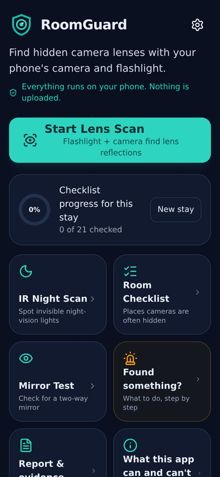
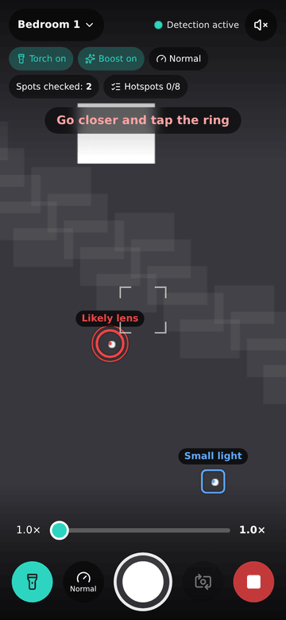
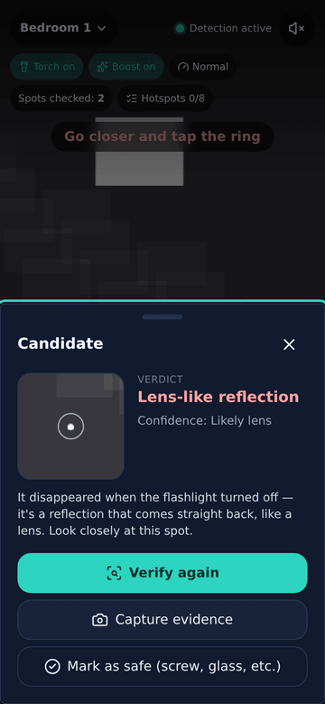
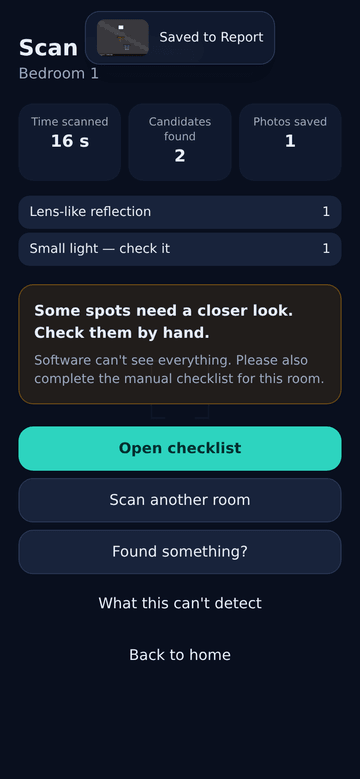
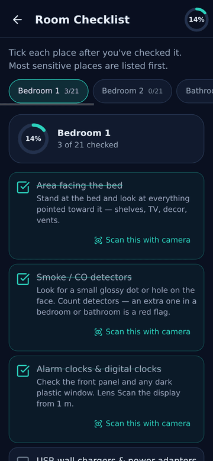
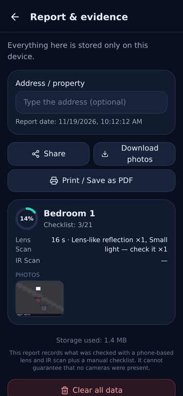
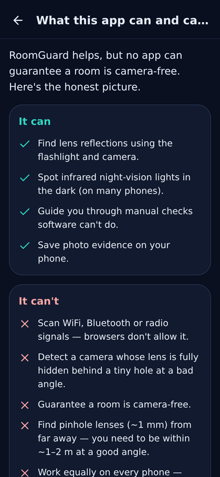
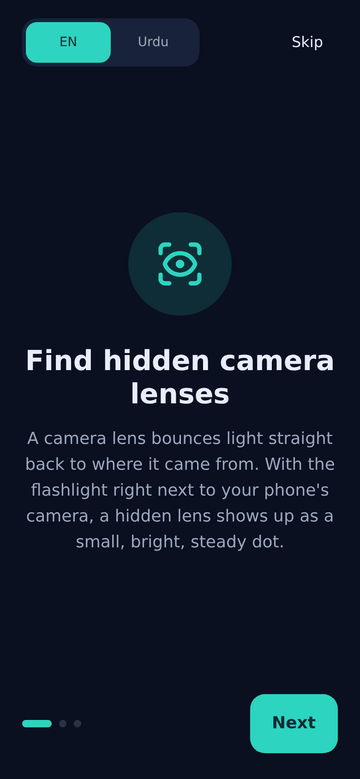

<div align="center">


# RoomGuard

**Find hidden camera lenses in your Airbnb, hotel or rental using your phone's camera and flashlight.**

A free, private, installable web app. Everything runs on your phone, and nothing is ever uploaded.


[**How to use it**](#-how-to-use-roomguard) · [Features](#-features) · [How it works](#-how-the-detection-works) · [Run it yourself](#-run-it-locally) · [Deploy](#-deploy-to-vercel) · [Limitations](#-what-it-can-and-cant-do)

<br />






<sub>Screenshots use a simulated test scene: a torch-dependent "lens" dot, an always-on LED and a lamp.</sub>

</div>

---

## 🎯 Why RoomGuard exists

Families staying in short-term rentals and hotels increasingly worry about hidden "spy" cameras: tiny lenses tucked into smoke detectors, USB chargers, clocks or decor, sometimes pointed at the bed or the shower. Dedicated detector gadgets cost money and most people don't carry one. Many "hidden camera detector" apps make promises a phone can't keep: fake RF meters, fake "AI scanning" progress bars.

RoomGuard takes the honest route. It uses the **physics a phone can actually measure**, and walks you through the checks that only your eyes and hands can do:

- **A camera lens is retro-reflective.** Light from a source right next to your eye bounces straight back toward it. Your phone's flashlight sits right next to its camera, so a hidden lens shows up on screen as a **small, very bright, round, steady dot** that stays locked to the same spot as you move. Ordinary shiny surfaces scatter light, or their glints slide and disappear as the angle changes.
- **Many hidden cameras have infrared night-vision LEDs.** They're invisible to your eyes but often visible to a phone camera as **purple or white glowing dots** in a dark room.

It never says a room is "100 % safe". When nothing is found it tells you exactly what it knows: *"No lens-like reflections detected in the areas you scanned"*, and reminds you to finish the manual checklist.

---

## 📱 How to use RoomGuard

### Before you start

1. **Open the app on your phone** in Chrome (Android) or Safari (iPhone). Don't open it inside Instagram, WhatsApp, Facebook or TikTok: those in-app browsers usually block the camera. The app will tell you if that's happening.
2. **Install it** (optional, recommended): tap **Install app** on Android, or **Share → Add to Home Screen** on iPhone. It then works **offline**, which helps when the rental's WiFi is bad.
3. **Make the room dark**: switch off the lights and close the curtains. Lens reflections stand out much more in the dark.

### Typical use case: you just arrived at an Airbnb

> You arrive with your family. Before unpacking, you spend 10–15 minutes checking the bedrooms and bathroom.

| Step | What you do | Where in the app |
| --- | --- | --- |
| 1 | Pick the room you're checking (Bedroom 1, Bathroom…) | Room chip at the top of the scan screen |
| 2 | Run a **Lens Scan** with the lights off | Home → **Start Lens Scan** |
| 3 | Check any ring that appears up close | Tap the ring |
| 4 | In a fully dark room, run the **IR Night Scan** | Home → **IR Night Scan** |
| 5 | Go through the **Room Checklist** by hand | Home → **Room Checklist** |
| 6 | Check mirrors facing the bed or shower | Home → **Mirror Test** |
| 7 | Repeat for each room, then save or share the **Report** | Home → **Report & evidence** |
| ⚠️ | If you find something | Home → **Found something?** |

### 1. Lens Scan, step by step

1. Tap **Start Lens Scan**, then **Tap to start the camera** and allow camera access.
2. The flashlight turns on automatically (on Android Chrome). **Glint Boost** darkens the image so lens glints pop.
3. Stand **1–2 m** from the walls and **sweep slowly**, left to right and top to bottom. Pay special attention to anything facing the **bed, shower or toilet**: smoke detectors, chargers, clocks, TVs, vents, decor.
4. Listen and watch. The clicking gets faster as a spot looks more lens-like, and the phone vibrates when something is found.
5. When a ring appears, **walk closer and tap it**. The app pulses the flashlight to check it (see below) and shows a zoomed preview.
6. Tap **Capture evidence** to save a photo with the markers, room name, verdict and timestamp burned in.
7. If it's harmless (a screw head, a glass bead…), tap **Mark as safe** and it stops alerting.
8. Tap the **red stop button** when done. You get a summary for that room.

**What the markers mean:**

| Marker | Meaning | What to do |
| --- | --- | --- |
| 🟠 Amber dashed ring, "Possible lens" | A small, bright, steady glint | Hold steady, move a little closer |
| 🔴 Red pulsing ring, "Likely lens" | Stable, lens-like and moving with the scene, or confirmed by the flashlight test | Go closer, inspect by hand, capture evidence |
| 🔵 Blue square, "Small light" | It stays lit with the flashlight off, so it's a light source such as an LED | Still check it: a camera's status LED looks like this too |
| ⚪ Grey ring, "Marked safe" | You marked it as harmless | Nothing |

**The flashlight check (Verify).** When a strong candidate appears, or when you tap a ring, the app switches the flashlight **off and on 3 times** and watches the spot:

- **It disappears when the light is off** → *Lens-like reflection*: light bouncing straight back, like a lens.
- **It stays bright** → *Small light — check it*: something that makes its own light.

> **iPhone users:** Safari doesn't let websites control the flashlight. Hold a **second light** (another phone's flashlight or a small torch) **right next to your phone's camera**, pointing the same way. It has to be right next to the lens because a lens reflects light only back toward the light source.

### 2. IR Night Scan

1. Open **IR Night Scan** and do the **30-second self-test**: point a TV or AC remote at your phone's camera and press a button. If you see a flashing light on screen, that camera can see infrared. Test the front and rear cameras.
2. Make the room **completely dark**.
3. Tap **Start IR scan**. It uses the front camera by default, because rear cameras often block IR.
4. Look around slowly. Rings labelled **"Possible IR light"** mark small glowing white or purple dots. Check what device each one belongs to.

### 3. Room Checklist (the part software can't do)

- Pick a room tab. The list puts the **most sensitive spots first**: the area facing the bed, the shower, the area facing the toilet, smoke detectors, chargers, clocks…
- Each item has a one-line **how to check** tip and a **Scan this with camera** shortcut.
- Tick items off as you go. Progress is saved for each room and for the whole stay.
- Read the **What to look for** tips: tiny 1–3 mm holes, devices plugged in for no reason, gadgets aimed at the bed, warm devices, faint clicking.

### 4. Mirror Test

Follow the four illustrated steps: lights off → press a light against the glass and look for a space behind it → cup your hands and look → knock and listen for a hollow sound. The popular "fingernail test" is **not reliable**, and the app says so. Tap **Mirror looks suspicious** if anything seems off.

### 5. If you find something

Open **Found something?** for a calm step-by-step guide:

1. Don't panic, and don't damage the device.
2. Take photos and a video of it and where it is.
3. Cover it (towel, tape) or unplug it, after photographing it.
4. Move your family to another room, or consider leaving.
5. Report it to the platform. **Airbnb has banned all indoor security cameras since 30 April 2024**, even visible ones. Contact Airbnb support from your trip page.
6. Contact local police if you believe you were recorded in a private space.
7. Tap **Generate report**.

### 6. Report & evidence

**Report & evidence** lists every room with its checklist progress, scan time, verdicts and photos (tap a photo for full screen with pinch-zoom). You can **Share** it (with photos, where the phone supports it), **Download photos**, **Print / Save as PDF** (a clean white layout with an address field), or **Clear all data**. Everything stays on your device.

### Tips for best results

- 🌑 **Darker is better.** Bright rooms hide glints, and the app will warn you ("Too bright — close the curtains").
- 🐢 **Slow is better than fast.** Detection needs a few steady frames to confirm a lens.
- 📏 **1–2 m away.** Pinhole lenses (~1 mm) are hard to see from across the room.
- 🔁 **Change angles.** A lens behind a hole may only show from certain directions.
- ✅ **Always finish the checklist.** The camera can't see a lens that's fully hidden.

<details>
<summary><b>🇵🇰 Roman Urdu mein mukhtasar tareeqa</b></summary>

<br />

App mein **Settings → Language → Roman Urdu** se poori app Roman Urdu mein ho jati hai.

1. **Kamre ki batti bujhayein** aur parde band karein.
2. Home par **Lens Scan shuru karein** dabayein, phir camera ki ijazat dein.
3. Deewaron se **1–2 meter door** reh kar phone ko **aahista aahista** baayein se daayein aur upar se neeche ghumayein.
4. **Peeli (amber) ring** = mumkin lens. **Laal ring** = ghaliban lens. **Neela dabba** = chhoti roshni (LED). Woh bhi check karein.
5. Ring par **tap karein**: app torch ko 3 dafa band/on kar ke check karti hai. Agar nuqta torch band hone par ghayab ho jaye to woh lens jaisi chamak hai.
6. **Saboot mehfooz karein** se tasveer save karein.
7. Phir **IR Night Scan** (bilkul andhere kamre mein), **Kamre ki Checklist** aur **Aaina Test** zaroor karein.
8. Kuch mile to **Kuch mila?** section ke qadam follow karein aur **Report** banayein.

> Yaad rahe: koi app 100 % guarantee nahi de sakti. Manual checklist hamesha mukammal karein.

</details>

---

## ✨ Features

- **Real-time Lens Scan**: flashlight + low exposure + a custom detector at ~15–30 analysed frames per second.
- **Flashlight verification**: tells a reflection apart from a light source, and allows for flashlight delay on each device.
- **IR Night Scan** with a remote-control self-test for each camera.
- **Geiger-style audio**, haptics and screen-reader announcements ("Possible lens detected, upper left").
- **Evidence capture** at full camera resolution, with markers, room, verdict and timestamp.
- **Room Checklist**: 23 hiding spots per room type, most sensitive first, with progress rings.
- **Mirror Test** and a **Found something?** action guide.
- **Report**: share, download, print / PDF.
- **Works offline** as an installable PWA.
- **English + Roman Urdu**.
- **Accessible**: colour + shape + text for every status, 44 px touch targets, visible focus, reduced-motion support.
- **Private**: no backend, no API routes, no analytics, no cookies, no uploads.

<div align="center">




</div>

---

## 🔒 Privacy

- The camera feed is processed **only in your browser**, in a Web Worker on your phone.
- Photos are saved in your browser's **IndexedDB**; settings and checklist ticks in **localStorage**.
- There is **no server code** at all: no API routes, database, analytics, tracking or cookies.
- **Clear all data** wipes everything from the device.

---

## ⚖️ What it can and can't do

| ✅ It can | ❌ It can't |
| --- | --- |
| Find lens reflections using the flashlight and camera | Scan WiFi, Bluetooth or radio signals (browsers don't allow it) |
| Spot IR night-vision lights in the dark (on many phones) | See a lens fully hidden behind a tiny hole at a bad angle |
| Guide you through manual checks | Guarantee a room is camera-free |
| Save photo evidence on your phone | Find ~1 mm pinhole lenses from far away (be within ~1–2 m) |
| | Work equally well on every phone (it depends on camera quality) |

Other honest caveats:

- Glossy screw heads and glass beads can also give steady glints. Use the flashlight check, look closely, and use *Mark as safe*.
- Flashlight control needs Android Chrome on most phones. It isn't available on iPhone.
- For WiFi devices, install a network scanner app (for example **Fing**) on the rental's WiFi and look for camera brands or unknown devices.

---

## 🧠 How the detection works

All detection code is **plain TypeScript with no DOM access** (`src/lib/detection/`), runs in a **Web Worker**, and is fully unit-tested on synthetic frames. No OpenCV, no TensorFlow.

```
camera frame ─► downscale (320–640 px, adaptive) ─► Web Worker
   │
   ├─ 1. Luminance  Y = 0.299R + 0.587G + 0.114B   (+ row/column profiles)
   ├─ 2. Integral image → O(1) local mean (15×15 box at 480 px)
   ├─ 3. Candidate mask: Y ≥ abs, Y − localMean ≥ contrast, Y ≥ mean + k·σ
   ├─ 4. 8-connected components (explicit stack, no recursion)
   ├─ 5. Filters: too big (lamps/windows), noise, streaks, edge blobs
   ├─ 6. Score: small, compact, very bright, dark surround, round, tint bonus
   ├─ 7. Tracking: global motion from projection profiles, 12-frame history,
   │     brightness/size stability, drift relative to the scene,
   │     Low → Possible → Likely with hysteresis
   └─ 8. Flashlight verification: actual torch state inferred from frame
         brightness; compare the spot's contrast with the torch on vs off
```

- **Speed**: ~2–5 ms per 480×270 frame. Buffers are reused, with no per-pixel allocations. Only one frame is processed at a time; frames are dropped rather than queued.
- **Latency**: a steady glint shows an amber ring on its **3rd frame (~130 ms at 15 fps)** and a red "Likely lens" on its **8th frame (~460 ms)**.
- **False-alarm killers**: specular glints that slide relative to the scene, vanish, or flicker in brightness/size never reach "Likely". Unit tests cover each case.

---

## 🛠 Run it locally

Requirements: Node.js 20+.

```bash
git clone https://github.com/khanareeb17/room-guard.git
```

```bash
cd room-guard && npm install
```

```bash
npm run dev
```

Open http://localhost:3000. Desktop webcams work on `localhost`, but have no flashlight.

| Script | What it does |
| --- | --- |
| `npm run dev` | Development server |
| `npm run dev:https` | Development server with a self-signed HTTPS certificate (for phones) |
| `npm run build` / `npm start` | Production build / server |
| `npm test` | Vitest unit tests (detection + geometry) |
| `npm run lint` | ESLint |
| `npm run typecheck` | `tsc --noEmit` |
| `npm run icons` | Regenerate PWA icons from SVG |

### Testing on a real phone

Phones only allow the camera on **HTTPS** pages:

- **Same WiFi**: run `npm run dev:https -- -H 0.0.0.0`, then open `https://<your-computer-IP>:3000` on the phone and accept the certificate warning.
- **Or** deploy a Vercel preview and open its URL.

**Debug tools**: in **Settings → Show debug panel** (or tap the logo 5 times) you can see fps, processing time, resolution, camera capabilities, a live threshold mask and every track's scores. In debug mode, **Use a video file instead of camera** runs the same pipeline on a recorded video. For a real test target, point the app at another phone's camera or a laptop webcam from 1–2 m in a dark room.

---

## 🚀 Deploy to Vercel

[](https://vercel.com/new/clone?repository-url=https%3A%2F%2Fgithub.com%2Fkhanareeb17%2Froom-guard)

Or: push to GitHub → **vercel.com → Add New → Project → Import** this repo → **Deploy**. No settings or environment variables are needed. Security headers (`Permissions-Policy: camera=(self)`, `X-Content-Type-Options`, `Referrer-Policy`, `X-Frame-Options`, COOP) are set in `next.config.ts`.

---

## 🌐 Browser support

| Browser | Support |
| --- | --- |
| **Android Chrome** | ✅ Full: flashlight control, Glint Boost, zoom, flashlight verification, vibration, install prompt (depends on what the phone exposes) |
| **iPhone Safari** | ✅ Camera, detection, IR scan, checklist, report, offline. ⚠️ No flashlight control (use a second light), no vibration. Install via *Share → Add to Home Screen* |
| **Desktop browsers** | ✅ Works with a webcam (useful for development); shows "Best on a phone" |
| **In-app browsers** (Instagram, Facebook, WhatsApp, TikTok) | ❌ Usually block the camera. The app detects this and offers "Open in Chrome / Safari" with a copy-link button |

---

## 📁 Project structure

```
src/
  app/                 layout, single page, manifest.ts, icons, globals.css (theme + print styles)
  components/
    views/             Home, LensScan, IrScan, Checklist, MirrorTest, FoundSomething, Report, Limits, Settings
    scanner/           ScannerScreen, CameraStage, DetectionOverlay, ScanHud, BottomControls,
                       CandidateSheet, CaptureButton, CameraError, CoachOverlay, DebugPanel
    ui/                Button, Card, Sheet, Toggle, Segmented, Slider, ProgressRing, Toasts, …
  hooks/               useCamera, useCameraControls, useWakeLock, useDetector, useAlerts, useHashView, …
  lib/
    detection/         luminance, integralImage, threshold, components, blobFeatures, scoring,
                       motion, tracker, torchVerify, irDetect, pipeline, types   ← pure TS
    i18n/              en.ts (typed keys), ur-roman.ts
    capture.ts, storage.ts, checklist-data.ts, geometry.ts, env.ts, settings.ts
  workers/             detector.worker.ts
public/                sw.js (offline service worker), icons/
tests/                 detection/*.test.ts (synthetic frames), geometry.test.ts
```

**Tech stack**: Next.js 16 (App Router, Turbopack) · React 19 · TypeScript (strict) · Tailwind CSS 4 · `idb-keyval` · `lucide-react` · Vitest. That's the whole dependency list.

---

## 📝 Design decisions

<details>
<summary>Choices made while building, and why</summary>

- **One route, hash-based views** (`#scan`, `#checklist`…) via `useSyncExternalStore`, so the browser/Android back button moves between screens.
- **System fonts**, not Google Fonts: nothing to fetch, faster, and works offline.
- **Small external stores** persisted to `localStorage` (settings, stay, checklist, results). **Photos** go in IndexedDB via `idb-keyval`.
- **Torch, exposure, zoom and focus live in one hook** (`useCameraControls`), because they share one camera track and keeping them together avoids constraint races.
- **Global motion from projection-profile alignment**, with the median motion of tracked spots as a fallback, so a single sliding glint can be told apart from the scene.
- **Brightness history uses blob "energy"** (area × contrast) instead of peak brightness, because lens peaks saturate at 255 and would always look stable.
- **Flashlight verification** holds the tracks while the torch blinks and infers the real torch state from frame brightness. If the frame never visibly changes, it answers *Not sure* rather than "light source".
- **Confidence levels**: Possible needs ≥ 3 hits and score ≥ 0.38. Likely needs ≥ 8 of the last 12 frames, score ≥ 0.55, stable brightness and low drift. A "light source" result is shown in blue and never dismissed.
- **Mark as safe** remembers the spot in scene coordinates for 30 s after last seen, and resets on room change or a new scan.
- **Tapping empty video zooms**: hardware zoom when available, otherwise a CSS digital zoom around the tap point that keeps the overlay aligned.
- **Auto-verify** waits until the first-use tip cards are closed, and only runs with the flashlight on.
- **Glint Boost** sets `exposureCompensation` to min + 25 % of its range, falling back to a short manual `exposureTime`.
- **Camera choice**: prefers the main rear camera over ultra-wide/tele/macro/depth and remembers the choice.
- **Evidence photos are stored un-mirrored**, even from the front camera.
- **Hand-written service worker**: network-first for pages, cache-first for hashed assets. It warms the detector worker so scans work offline after one online visit. It registers in production only.

</details>

---

## ⚠️ Disclaimer

RoomGuard is a helper, not a guarantee. A phone camera can miss well-hidden cameras, and it can flag harmless shiny objects. Always complete the manual checks, and if you believe you have been recorded, contact the platform and the local police.
